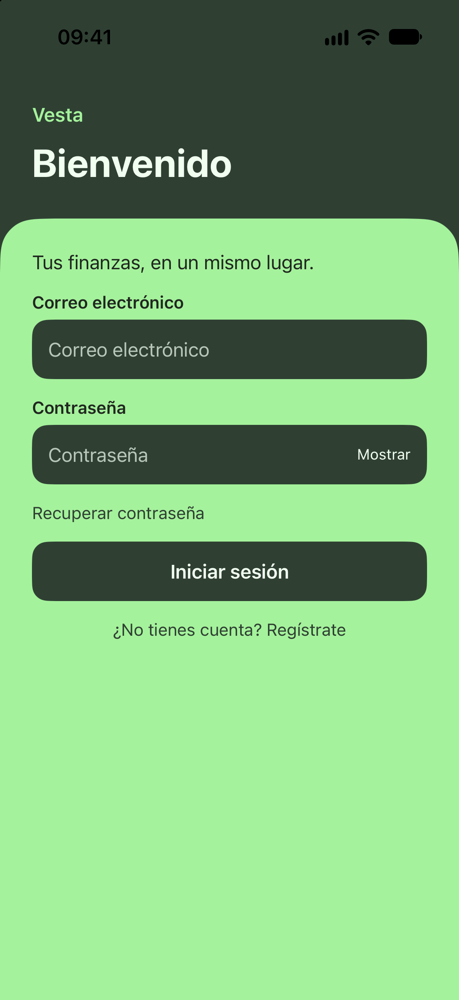
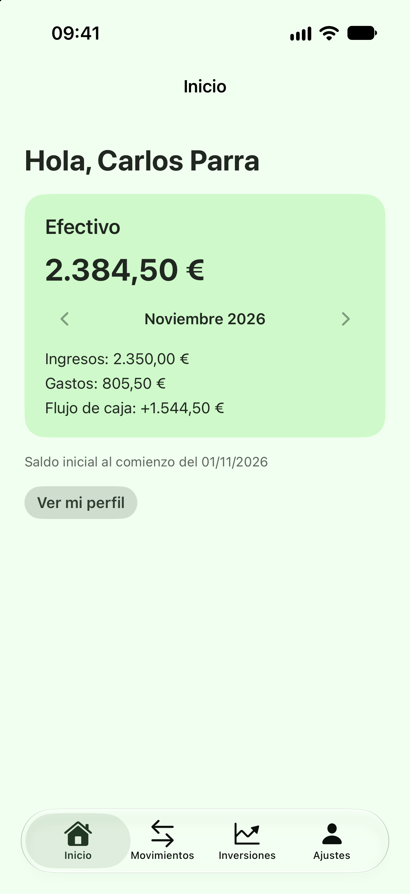

# Vesta para iOS

[](https://github.com/Carlos-PC05/uni-dam-ios/actions/workflows/ios.yml)

Réplica sencilla en SwiftUI de [uni-dam-android](https://github.com/Carlos-PC05/uni-dam-android/tree/develop), la práctica final de Desarrollo de Aplicaciones Móviles (UCAM). El repositorio sigue la convención `uni-<nombre>` descrita en [reglas](https://github.com/Carlos-PC05/reglas).

## Alcance

La aplicación reproduce el recorrido principal de Vesta: registro e inicio de sesión, saldo inicial, movimientos y resumen mensual de efectivo. Para que el proyecto se pueda compilar y probar sin credenciales, la persistencia es local en lugar de Firebase. No se incluye `google-services.json` ni se añaden dependencias externas.

Funcionalidades incluidas:

- Registro con nombre, correo y contraseña, con la misma política que la versión Android: entre 12 y 4096 caracteres, una letra, un número y un símbolo de `-_?#@.`.
- Inicio de sesión, sesión persistente y cierre de sesión.
- Saldo inicial en euros con fecha `DD/MM/AAAA`, incluidos importes negativos y cero.
- Registro de movimientos con importe positivo, fecha entre el saldo inicial y hoy, categoría y nota de hasta 500 caracteres.
- Cálculo del efectivo total, ingresos, gastos y flujo de caja del mes seleccionado.
- Sección de Inversiones marcada como pendiente, igual que en la aplicación original.
- Perfil de la cuenta y recuperación de contraseña simulada con una respuesta genérica.

## Capturas

| Acceso | Inicio |
| --- | --- |
|  |  |

## Requisitos

- macOS con Xcode 16.4 o posterior.
- iOS 17 o posterior.
- No se necesita cuenta de Firebase ni conexión a Internet para ejecutar la réplica.

## Ejecutar

```sh
git clone https://github.com/Carlos-PC05/uni-dam-ios.git
cd uni-dam-ios
open Vesta.xcodeproj
```

En Xcode, selecciona el esquema compartido **Vesta** y un simulador de iPhone. Pulsa **Cmd+R** para ejecutar la app o **Cmd+U** para compilar y ejecutar las pruebas. Para probar en un dispositivo físico, asigna tu equipo de desarrollo en *Signing & Capabilities*.

Para abrir la app con una cuenta de demostración y movimientos de ejemplo, añade la variable de entorno `VESTA_DEMO=1` al esquema (solo en compilaciones **Debug**). La cuenta es `carlos@example.com` y la contraseña `VestaSegura#2024`.

## Pruebas

El proyecto incluye **22 pruebas de Swift Testing** sobre las piezas que concentran la lógica:

| Archivo | Qué comprueba |
| --- | --- |
| `MoneyTests` | Interpretación de importes con coma o punto, rechazo de más de dos decimales y formato en euros. |
| `CalendarDayTests` | Fechas `DD/MM/AAAA`, rechazo de fechas imposibles y cambio de mes entre años. |
| `AuthValidationTests` | Correo, nombre, política de contraseña y confirmación. |
| `CashFlowTests` | Separación de ingresos y gastos, filtrado por mes y cálculo del neto. |
| `FinanceStoreTests` | Alta del saldo, movimientos válidos, fechas fuera de rango y persistencia en JSON. |
| `AccountStoreTests` | Registro, autenticación, correo duplicado, hash de contraseña y actualización del nombre. |

GitHub Actions compila la app y ejecuta la suite con Xcode 16.4 en un iPhone 16 con iOS 18.5 después de cada push. La ejecución publica el artefacto **evidencia-ios** con los logs, el resultado de Xcode (`.xcresult`) y una captura de la pantalla de acceso.

## Arquitectura

```
Vesta/
  AppModel.swift              sesión y estado raíz
  Models/                     dinero, fechas, perfil, saldo y movimientos
  Services/                   cuentas, sesión y persistencia JSON
  ViewModels/                 validación y estado financiero observable
  Views/                      SwiftUI, organizado por flujo
```

- **SwiftUI + Observation**: `AppModel` decide entre acceso, perfil incompleto y navegación privada. `FinanceStore` mantiene el saldo y los movimientos de la cuenta activa.
- **Persistencia local**: cada cuenta guarda su saldo y sus movimientos en `Application Support/Vesta/users/<id>.json`. Las cuentas viven en `Application Support/Vesta/accounts.json`.
- **Contraseñas**: se guardan como SHA-256 con una sal aleatoria, nunca en claro. Es una medida adecuada para una demo local, no un sistema de autenticación de producción.
- **Fechas**: se almacenan como días desde el 1 de enero de 1970, igual que el campo `dia` de Firestore en Android, para que no cambien al viajar entre husos horarios.

## Diferencias con la versión Android

- Firebase Authentication y Firestore se sustituyen por almacenamiento local. No hay cuentas remotas ni sincronización entre dispositivos.
- La recuperación de contraseña muestra el mismo mensaje genérico, pero no envía un correo real.
- No se implementa el guardado pendiente cifrado con Android Keystore: al ser una escritura local, el resultado es inmediato.
- La interfaz adapta la navegación de Compose a `TabView` y `NavigationStack`, manteniendo la paleta, los formularios y los estados de error.

## Licencia

Proyecto académico. Las imágenes y marcas de la aplicación original pertenecen a sus autores.
